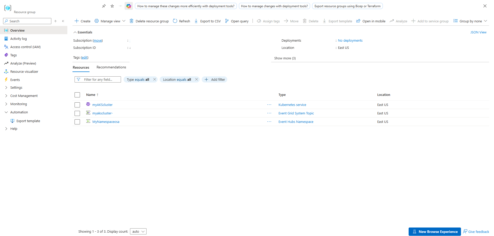
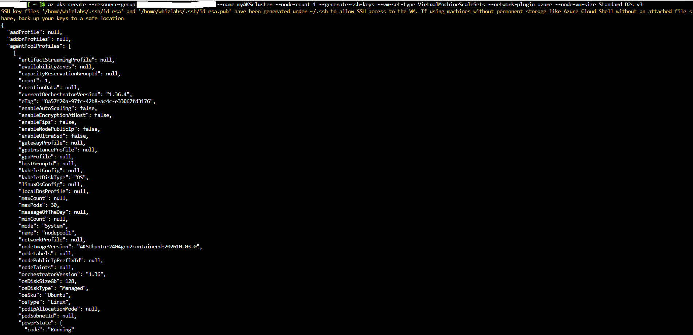
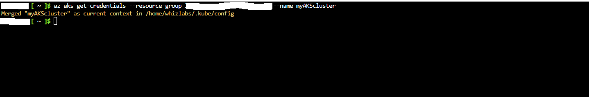
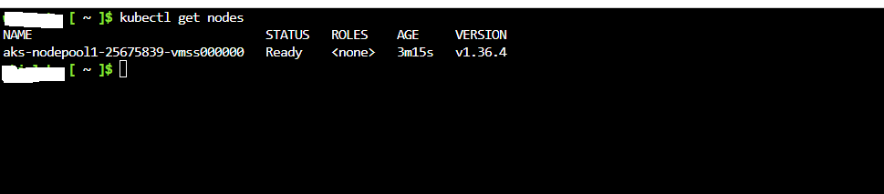
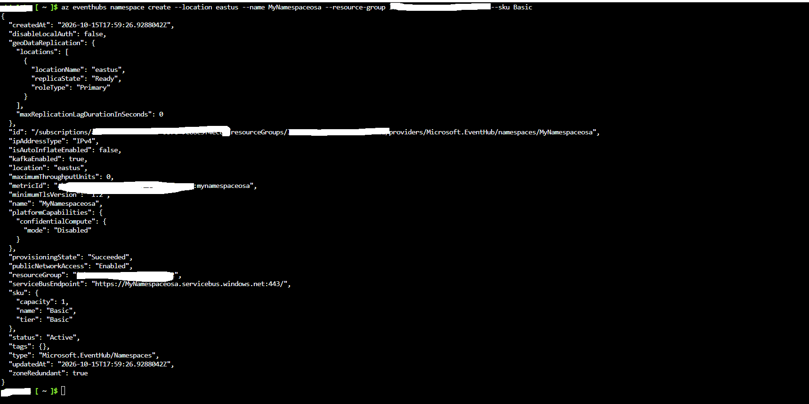
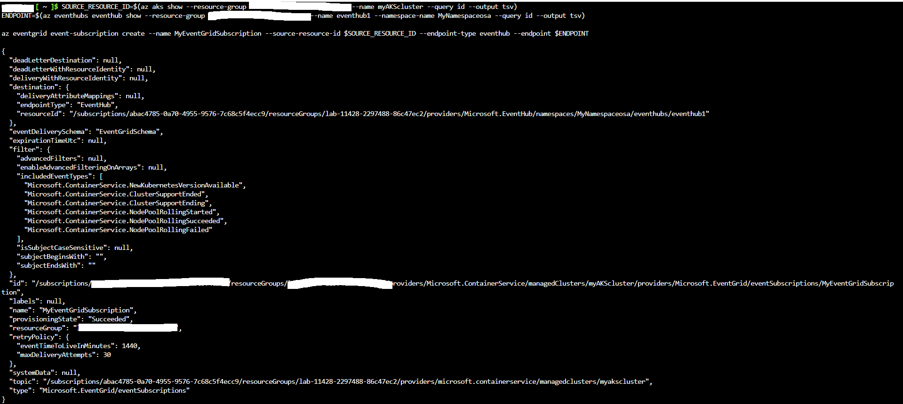
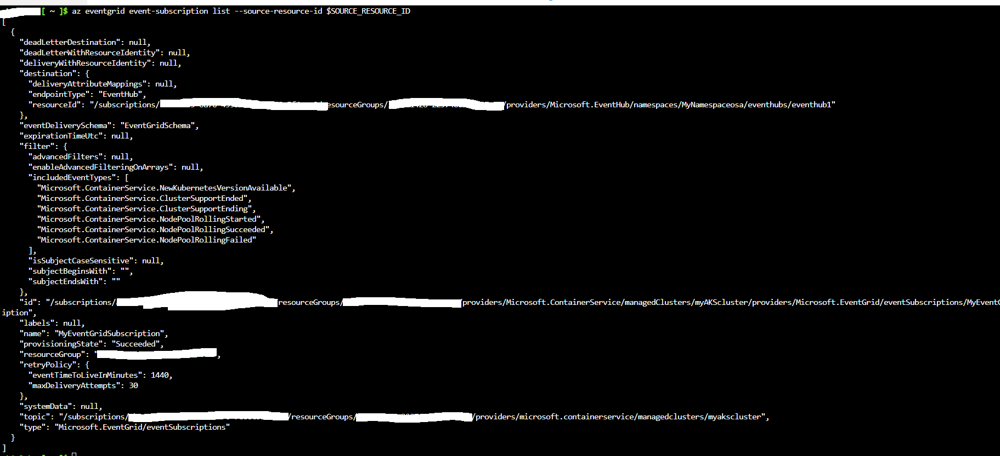
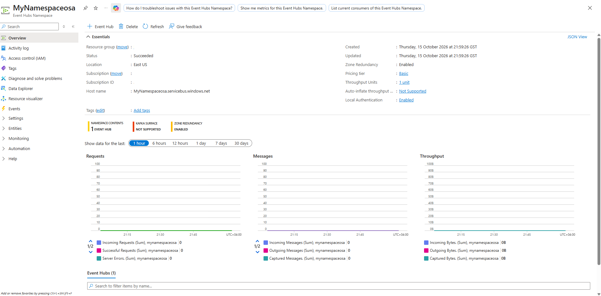

# Subscribing to Azure Kubernetes Service (AKS) Events with Azure Event Grid

Comprehensive detailing the architecture, provisioning, and configuration of an event-driven telemetry pipeline for Azure Kubernetes Service (AKS). The deployment routes cluster and node pool lifecycle events (such as version availability and rolling upgrades) from an AKS cluster (`myAKScluster`) to an Azure Event Hubs instance (`eventhub1`) using Azure Event Grid system topics and event subscriptions.

---

## 1. Architecture & Provisioned Resources

### Core Infrastructure Topology

| Resource Type | Resource Name | Specification / Tier | Region / Location |
| :--- | :--- | :--- | :--- |
| **Kubernetes Service** | `myAKScluster` | Free Tier, Kubernetes 1.36, System Assigned Managed Identity | East US |
| **Node Pool** | `nodepool1` | 1 Node (`Standard_D2s_v3`), VirtualMachineScaleSets, Ubuntu | East US |
| **Event Hubs Namespace** | `MyNamespaceosa` | Basic Tier, 1 Throughput Unit, Zone Redundant | East US |
| **Event Hub** | `eventhub1` | 1 Partition, 1 Day Retention | East US |
| **Event Grid System Topic** | `myakscluster-...` | Source: `Microsoft.ContainerService/managedClusters` | East US |
| **Event Subscription** | `MyEventGridSubscription` | Endpoint: EventHub, Schema: EventGridSchema | Global / East US |

---

### Provisioned Environment Validation

*Resource group overview confirming successful provisioning of the AKS cluster, Event Grid System Topic, and Event Hubs Namespace.*

---

## 2. Step-by-Step Implementation

### Step 1: Provision Azure Kubernetes Service (AKS) Cluster

Executed Azure CLI deployment commands to provision the managed Kubernetes cluster (`myAKScluster`) with a single-node Linux agent pool.

* **Cluster Name:** `myAKScluster`
* **Node Sizing:** `Standard_D2s_v3` (2 vCPUs, 4 GiB memory)
* **Kubernetes Version:** `1.36.4`
* **Network Plugin:** Azure CNI

*CLI execution output confirming successful cluster provisioning and running power state.*

---

### Step 2: Establish Kubernetes Context and Validate Cluster Nodes

Merged cluster access credentials into the local kubeconfig context and verified node readiness using `kubectl`.

* **Context Path:** `/home/whizlabs/.kube/config`
* **Node Name:** `aks-nodepool1-25675839-vmss000000`
* **Status:** `Ready`

*Retrieving cluster credentials and merging context.*

*Validating node readiness and orchestrator version via kubectl.*

---

### Step 3: Deploy Event Hubs Namespace and Instance

Created the target Event Hubs Namespace (`MyNamespaceosa`) and Event Hub (`eventhub1`) to serve as the destination endpoint for telemetry event streams.

* **Namespace Name:** `MyNamespaceosa`
* **SKU:** Basic
* **Service Bus Endpoint:** `https://MyNamespaceosa.servicebus.windows.net:443/`

*CLI JSON output detailing successful provisioning of the Event Hubs namespace.*

---

### Step 4: Configure Event Grid Subscription for AKS Events

Created an Event Grid subscription (`MyEventGridSubscription`) linking the AKS cluster source to the Event Hub destination, filtering for critical cluster and node pool lifecycle event types.

* **Subscription Name:** `MyEventGridSubscription`
* **Endpoint Type:** `EventHub` (`MyNamespaceosa/eventhubs/eventhub1`)
* **Included Event Types:** `NewKubernetesVersionAvailable`, `ClusterSupportEnded`, `ClusterSupportEnding`, `NodePoolRollingStarted`, `NodePoolRollingSucceeded`, `NodePoolRollingFailed`

*Executing Event Grid subscription creation mapping AKS source events to the Event Hub endpoint.*

---

### Step 5: Verify Event Subscription Configuration

Queried Event Grid subscription details for the AKS resource ID to confirm active provisioning status and rule parameters.

* **Provisioning State:** `Succeeded`
* **Retry Policy:** 30 Max Delivery Attempts, 1440 Minutes Time-To-Live

*Checking Event Grid subscription parameters via Azure CLI.*

---

### Step 6: Validate Event Hubs Metrics and Consumer Endpoint

Inspected the Azure Portal overview for `MyNamespaceosa` to verify messaging metrics, active Event Hub entity registration, and endpoint operational health.

* **Namespace Contents:** 1 Event Hub (`eventhub1`)
* **Status:** `Succeeded`

*Portal validation showing active Event Hub metrics and namespace status.*
